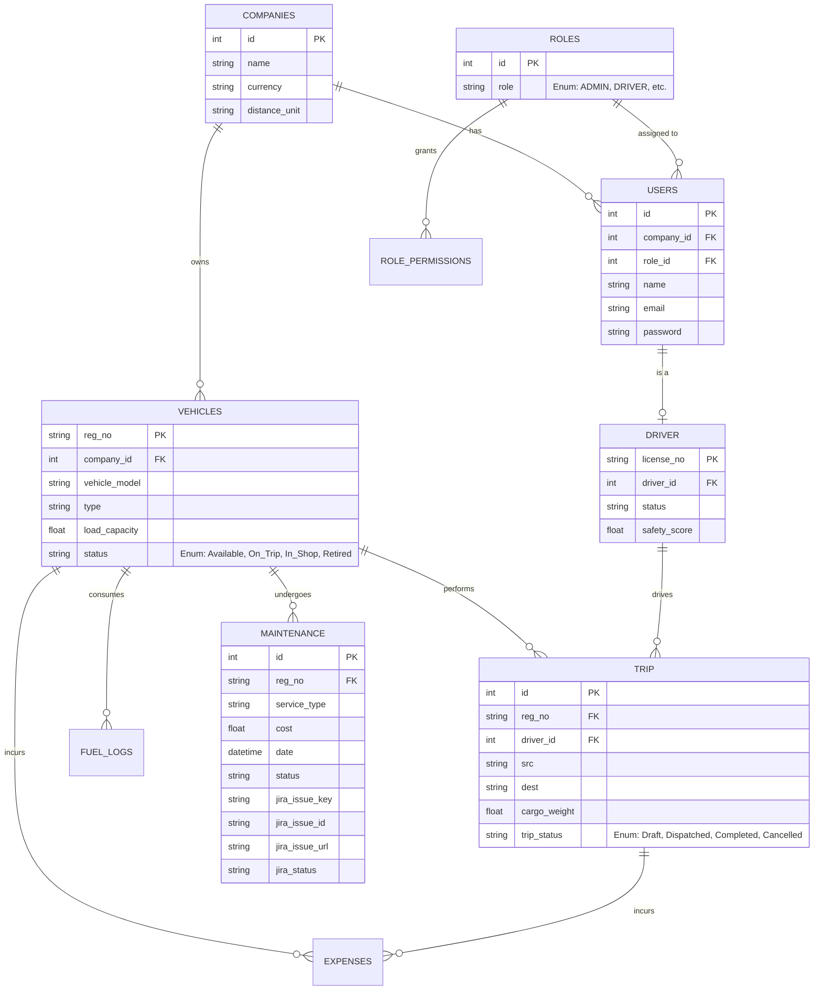
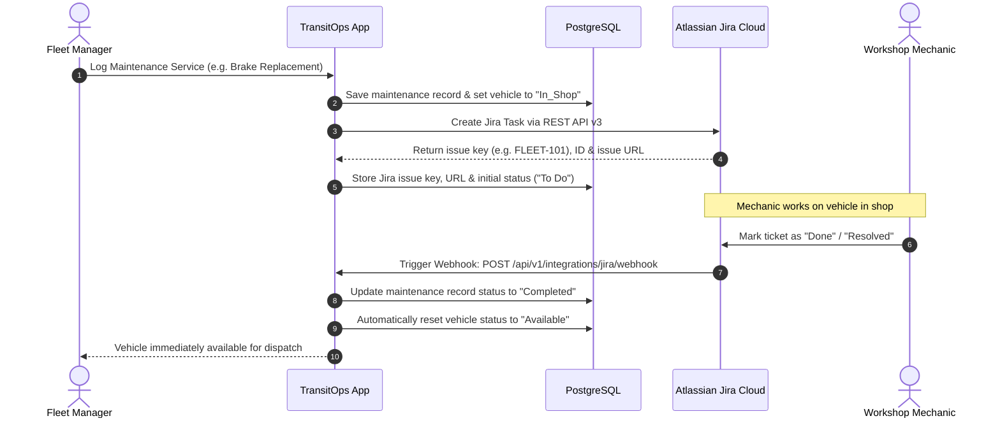
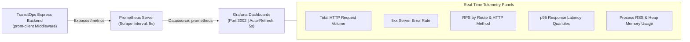

# TransitOps - Fleet & Logistics Management System

TransitOps is an enterprise-grade, full-stack logistics and fleet management platform engineered for real-time fleet tracking, driver allocation, payload optimization, trip dispatching, fuel expenditure analytics, and automated maintenance work orders. 

The system features robust multi-tenant isolation, role-based access control (RBAC), bi-directional Atlassian Jira synchronization, Model Context Protocol (MCP v2) support, real-time Prometheus & Grafana observability, and automated 1-click AWS EC2 deployment fronted by a Caddy reverse proxy.

---

## 🌟 Key Features

- **Fleet & Vehicle Inventory**: Real-time vehicle lifecycle tracking (`Available`, `On_Trip`, `In_Shop`, `Retired`), payload capacity enforcement, odometer logging, and acquisition cost analytics.
- **Driver Management**: Driver roster, safety score calculations, license validation with expiry warnings, and trip completion history.
- **Trip Dispatching & Live Mapping**: Interactive Leaflet maps with dynamic routing (`src_lat`, `src_lng`, `dest_lat`, `dest_lng`), cargo weight validation against vehicle limits, and a real-time dispatch Kanban board.
- **Fuel & Expense Tracking**: Detailed fuel consumption logs with economy calculations (km/L) and trip-linked operational expense tracking (tolls, parking, repairs, miscellaneous).
- **Maintenance & Work Orders**: Schedule services (Routine Service, Oil Change, Tire Replacement, Brake Service, Engine Repair), automatically transition vehicle status to `In_Shop`, and generate synchronized Atlassian Jira work tickets.
- **Bi-Directional Atlassian Jira Sync**: Automatic ticket creation in Jira upon maintenance logging, combined with an inbound webhook listener (`POST /api/v1/integrations/jira/webhook`) that marks work orders `Completed` and returns vehicles to `Available` when Jira issues are resolved.
- **Atlassian Remote MCP v2**: Native Model Context Protocol (`https://mcp.atlassian.com/v2/mcp`) integration supporting AI agents with OAuth 2.1 authentication.
- **Role-Based Access Control (RBAC)**: Fine-grained resource permissions across resources (`FLEET`, `DRIVERS`, `TRIPS`, `FUEL_EXPENSE`, `ANALYTICS`) for `ADMIN`, `FLEET_MANAGER`, `DISPATCHER`, `DRIVER`, `SAFETY_OFFICER`, and `FINANCIAL_ANALYST`.
- **Multi-Tenancy & Customization**: Organization-level isolation by company ID with configurable currencies (`INR`, `USD`, `EUR`, etc.) and distance measurement units.
- **Real-Time Observability Stack**: Native Prometheus metrics endpoint (`/metrics`) with a high-frequency **5-second scrape interval** and pre-provisioned Grafana dashboards tracking throughput, latency quantiles (p95), error rates, and JVM/Node memory.
- **Automated AWS Production Deployment**: 1-click EC2 provisioning script with Caddy reverse proxy, zero-downtime updates, automated swap configuration, and continuous deployment via GitHub Actions.

---

## 🏗 System Architecture

The TransitOps production stack is containerized with Docker Compose and deployed on AWS EC2, fronted by Caddy to provide unified HTTP/HTTPS routing, automatic SSL, and zero-CORS communication.

```mermaid
graph TD
    Client["🌐 Web Browser / Client / AI Agents"] -->|HTTP / HTTPS (Ports 80/443)| Caddy["🛡️ Caddy Reverse Proxy"]
    
    subgraph AWS_EC2 ["AWS EC2 Production Environment (Ubuntu 24.04 LTS)"]
        Caddy -->|/* (Next.js SSR & Static)| Frontend["🖥️ Next.js 19 Frontend<br/>(App Router, React 19, Tailwind)"]
        Caddy -->|/api/*, /health, /docs, /metrics| Backend["⚙️ Express.js API Backend<br/>(Node 22, TypeScript, Prisma)"]
        
        Backend -->|Prisma ORM (Connection Pool)| Postgres[("🐘 PostgreSQL 15<br/>(Persistent Volume)")]
        
        Prometheus["📊 Prometheus Server<br/>(Scrape Interval: 5s)"] -->|Scrapes /metrics| Backend
        Grafana["📈 Grafana Dashboard<br/>(Port 3002, Refresh: 5s)"] -->|Queries Metrics| Prometheus
    end

    subgraph External_Integrations ["External Cloud & AI Integrations"]
        Backend -->|REST API v3 (Create Issue)| Jira["🎫 Atlassian Jira Cloud"]
        Jira -->|Inbound Webhook (/api/v1/integrations/jira/webhook)| Caddy
        AIAgents["🤖 AI Coding Assistants"] -->|MCP v2 Streamable HTTP| AtlassianMCP["🔗 Atlassian Remote MCP Server"]
    end
```

---

## 🗄 Database Schema (ERD)

The database schema is managed through Prisma ORM with strict referential integrity:



---

## 🔗 Atlassian Jira & MCP Integration

TransitOps integrates directly with Atlassian Jira to eliminate manual communication between workshop mechanics and fleet managers:



### 1. Jira Work Order Synchronization
* **Issue Generation**: Every logged maintenance entry creates an issue in your designated Jira project (`JIRA_PROJECT_KEY`).
* **Metadata Persistence**: The maintenance record retains `jira_issue_key`, `jira_issue_id`, `jira_issue_url`, and live `jira_status`.
* **Webhook Endpoint**: `POST /api/v1/integrations/jira/webhook`
  * When a workshop mechanic or technician marks a Jira issue as `Done` or `Resolved`, the webhook receiver automatically marks the internal work order as `Completed` and restores the vehicle to `Available` status for dispatchers.

### 2. Atlassian Remote Model Context Protocol (MCP v2)
TransitOps provides built-in configuration for the official Atlassian Remote MCP server, enabling AI agents to read, query, and mutate Jira issues and Confluence spaces:
* **Endpoint**: `https://mcp.atlassian.com/v2/mcp`
* **Transport**: Streamable HTTP
* **Authentication**: OAuth 2.1 / Personal API Token
* **Configuration File**: [`.agents/mcp_config.json`](./.agents/mcp_config.json)

---

## 📊 Observability: Prometheus & Grafana

The system includes a pre-configured observability stack tracking real-time metrics with high temporal resolution:



### Configuration Details:
* **Prometheus Scrape Interval**: Set to **`5s`** in [`monitoring/prometheus.yml`](./monitoring/prometheus.yml) for rapid detection of performance anomalies and spikes.
* **Auto-Provisioned Grafana Datasource**: Configured with explicit `uid: prometheus` in [`monitoring/grafana/provisioning/datasources/prometheus.yml`](./monitoring/grafana/provisioning/datasources/prometheus.yml).
* **Pre-Loaded Dashboard**: Automatically loads `Odoo Backend - Service Overview` from [`monitoring/grafana/provisioning/dashboards/grafana-dashboard.json`](./monitoring/grafana/provisioning/dashboards/grafana-dashboard.json).
* **Dashboard Access**: Available out of the box on port `3002` (Default credentials: `admin` / `admin`).

---

## ☁️ AWS Production Deployment

TransitOps features an automated, idempotent 1-click provisioning script targeting AWS EC2 (Free-Tier eligible) with zero manual infrastructure steps.

### Provisioning Workflow (`./aws/provision-ec2.sh`)

1. **Identity & Region Verification**: Validates AWS credentials via `aws sts get-caller-identity`.
2. **Dynamic Key Pair Management**: Checks for existing keys in AWS; if the local `.pem` key is missing, automatically recreates the key pair and saves [`fleetops-key.pem`](./fleetops-key.pem) with secure `400` permissions.
3. **Security Group Configuration**: Creates `fleetops-production-sg` in the target VPC, opening:
   - **Port 22**: Secure SSH administrative access.
   - **Port 80 / 443**: HTTP / HTTPS web traffic (Caddy reverse proxy).
   - **Port 3002**: Grafana monitoring dashboard.
4. **Cloud-Init Automated Boot Script**:
   - Provisions a **2 GB Swapfile** to ensure memory stability during Next.js builds on smaller instances (`t3.small` / `t2.micro`).
   - Installs native **Docker Engine** (`docker-ce`) and **Docker Compose Plugin**.
   - Clones the Git repository and launches the stack with [`docker-compose.prod.yml`](./docker-compose.prod.yml).
   - Runs automated Prisma database migrations (`prisma migrate deploy`) and initial data seeding.

### Running the Provisioner:

```bash
cd asd-d_mpr
chmod +x aws/provision-ec2.sh
./aws/provision-ec2.sh
```

### Production Access Points:
- **Frontend Application**: `http://<EC2_PUBLIC_IP>`
- **Backend API**: `http://<EC2_PUBLIC_IP>/api/v1`
- **Health Check**: `http://<EC2_PUBLIC_IP>/health`
- **Interactive Swagger Docs**: `http://<EC2_PUBLIC_IP>/docs`
- **Prometheus Metrics**: `http://<EC2_PUBLIC_IP>/metrics`
- **Grafana Dashboard**: `http://<EC2_PUBLIC_IP>:3002` *(Credentials: `admin` / `admin`)*

---

## 🤖 Continuous Integration & Deployment (GitHub Actions)

The repository includes end-to-end automated workflows located in `.github/workflows/`:

1. **[CI Pipeline (`.github/workflows/ci.yml`)](./.github/workflows/ci.yml)**:
   - **Backend Verification**: Dependency caching, Prisma Client generation, strict TypeScript type checking (`tsc --noEmit`).
   - **Frontend Verification**: Production build validation (`pnpm build`).
   - **Container Verification**: Multi-stage Docker build testing for backend and frontend.
   - **Manifest Syntax Checks**: Syntax validation for Docker Compose and Prometheus configs.

2. **[CD Pipeline (`.github/workflows/deploy.yml`)](./.github/workflows/deploy.yml)**:
   - Triggers on every push to `main`.
   - Connects securely to the production EC2 instance over SSH.
   - Pulls latest code, builds updated images, applies Prisma migrations, restarts services with zero downtime, and prunes dangling images.

### Setting Up GitHub Secrets for CD:
Add these secrets under **Settings > Secrets and variables > Actions**:
- `EC2_HOST`: The Public IP address of your EC2 instance.
- `EC2_USER`: `ubuntu`
- `EC2_SSH_KEY`: The entire contents of [`fleetops-key.pem`](./fleetops-key.pem).

---

## 🛠 Local Development Setup

### Prerequisites
- Node.js (v20+)
- pnpm (v9+)
- PostgreSQL (or Docker)

### Option A: Running with Docker Compose (Recommended)

To run the complete application along with PostgreSQL, Prometheus, and Grafana locally:

```bash
docker compose up --build
```

- **Frontend**: `http://localhost:3001`
- **Backend API**: `http://localhost:3000`
- **Grafana**: `http://localhost:3002` *(admin / admin)*
- **Prometheus**: `http://localhost:9090`

### Option B: Running Bare-Metal Locally

#### 1. Backend Setup
```bash
cd backend
pnpm install
cp .env.example .env
# Configure DATABASE_URL, JWT_SECRET, and optional JIRA credentials
pnpm exec prisma migrate dev
pnpm exec prisma db seed
pnpm dev
```

#### 2. Frontend Setup
```bash
cd frontend
pnpm install
pnpm dev
```

---

## 🤝 Contributing

1. Fork the repository.
2. Create your feature branch (`git checkout -b feature/amazing-feature`).
3. Commit your changes (`git commit -m 'feat: Add amazing feature'`).
4. Push to your branch (`git push origin feature/amazing-feature`).
5. Open a Pull Request.

---

## 📄 License

This project is licensed under the MIT License.
